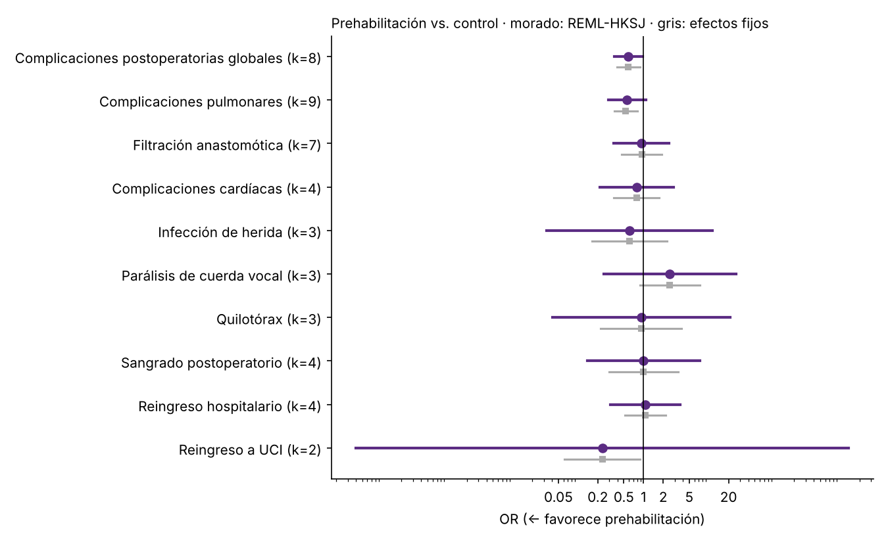

# Prehabilitación vs. no prehabilitación en cirugía oncológica GI alta — re-análisis reproducible

Re-análisis abierto y reproducible de los datos por estudio publicados en:

> Boosting recovery before surgery: The impact of prehabilitation on upper gastrointestinal cancer patients – A quantitative comparative analysis. *PLOS ONE* 20(3): e0315734 (2025). https://doi.org/10.1371/journal.pone.0315734 — licencia CC-BY 4.0.

12 estudios (2 ECA + 10 observacionales), 832 pacientes con cáncer de esófago, unión gastroesofágica o gástrico sometidos a cirugía, comparando **prehabilitación** (ejercicio ± nutrición ± apoyo psicológico) vs. **cuidado habitual**.

## ¿Por qué datos agregados y no por paciente?

Se buscaron datasets abiertos de pacientes individuales (IPD) con brazo prehabilitado y brazo control en Dryad, Zenodo, Figshare, Harvard Dataverse, Mendeley Data y material suplementario de PLOS ONE (noviembre 2026). **No se encontró ninguno de acceso libre**: los ensayos grandes comparten IPD solo "a solicitud" o vía Vivli, y el único dataset abierto de prehabilitación en Dryad (Hôpital Foch, 2021) es de un solo brazo (todos prehabilitados, comparando por edad). Por eso se usaron las estimaciones por estudio (log OR y SE) publicadas en las Figs 2–4 del paper, que sí son abiertas.

## Qué agrega este re-análisis

El paper original usó **solo efectos fijos**. Aquí se agregan:

1. **Efectos aleatorios** REML con ajuste Hartung-Knapp-Sidik-Jonkman (más apropiado con pocos estudios heterogéneos en diseño).
2. **Intervalos de predicción 95%** (rango esperable del efecto en un nuevo centro).
3. **Sensibilidad por diseño** (ECA vs. observacional) y **leave-one-out**.
4. **Subgrupos** (diseño, tipo de cáncer, neoadyuvancia, modalidad) con test Q entre grupos.
5. **Test de Egger** para outcomes con k ≥ 8.

Validación: el modelo de efectos fijos reproduce exactamente los OR del paper (p. ej. complicaciones globales 0,59 [0,39–0,88]; pulmonares 0,54 [0,36–0,80]).

## Resultados principales

| Outcome | k (ECA) | OR efectos fijos (paper) | OR REML-HKSJ | Intervalo de predicción 95% | I² |
|---|---|---|---|---|---|
| Complicaciones globales | 8 (1) | 0,59 [0,39–0,88] | **0,59 [0,36–0,96]**, p = 0,04 | 0,36–0,98 | 0% |
| Complicaciones pulmonares | 9 (1) | 0,54 [0,36–0,80] | **0,56 [0,29–1,09]**, p = 0,08 | 0,21–1,52 | 40% |
| Filtración anastomótica | 7 (0) | 0,94 [0,46–1,92] | 0,92 [0,35–2,43] | 0,24–3,54 | 0% |
| Complicaciones cardíacas | 4 (0) | 0,79 [0,35–1,75] | 0,79 [0,21–2,89] | — | 0% |
| Reingreso hospitalario | 4 (1) | 1,06 [0,52–2,17] | 1,06 [0,31–3,62] | — | 0% |
| Reingreso a UCI | 2 (1) | 0,23 [0,06–0,89] | no estimable con 2 estudios | — | 0% |

Herida, parálisis de cuerda vocal, quilotórax y sangrado (k = 3–4): sin diferencias, IC muy amplios. Tabla completa en [`results/summary_by_outcome.csv`](results/summary_by_outcome.csv).



### Sensibilidad

- **Solo ECA**: complicaciones globales OR 0,54 [0,16–1,80] (1 ECA, n = 51); pulmonares OR 0,40 [0,12–1,33] (1 ECA, n = 48). La dirección coincide, pero ningún ECA tiene potencia por sí solo.
- **Leave-one-out (REML-HKSJ)**: en complicaciones globales, al retirar 6 de 8 estudios el IC cruza 1 (OR entre 0,52 y 0,64). En pulmonares, 7 de 9 omisiones dejan el resultado no significativo.
- **Subgrupo pulmonar por tratamiento**: neoadyuvancia + cirugía OR 0,47 [0,25–0,87] vs. solo cirugía OR 1,79 (FE) — Q entre grupos p = 0,045. El subgrupo "solo cirugía" son 2 estudios japoneses de gástrico, así que tratamiento, tipo de cáncer y país están confundidos.
- **Egger**: sin asimetría detectable (p = 0,39 y 0,30), pero con 8–9 estudios el test tiene muy poca potencia.

## Conclusiones

1. **La dirección del efecto es consistente**: la prehabilitación se asocia a ~40% menos odds de complicaciones postoperatorias globales y ~45% menos odds de complicaciones pulmonares.
2. **La certeza es menor de lo que sugiere el paper**. Con un modelo de efectos aleatorios, el efecto sobre complicaciones pulmonares deja de ser significativo (IC hasta 1,09) y el intervalo de predicción incluye daño (hasta 1,52). El efecto global sobrevive (p = 0,04) pero es frágil al leave-one-out.
3. **La evidencia es casi toda observacional** (10/12 estudios). La prehabilitación no se asigna al azar en esos estudios: los pacientes más motivados o en mejor forma pueden tener más probabilidad de recibirla, lo que sesga a favor de la intervención.
4. **No hay señal de efecto** en filtración anastomótica, complicaciones cardíacas, reingreso ni otras complicaciones específicas.
5. **El beneficio pulmonar parece concentrarse en esófago con neoadyuvancia**, lo cual es biológicamente plausible (la neoadyuvancia deteriora capacidad funcional y la prehabilitación puede contrarrestarlo), pero es una hipótesis, no una conclusión.
6. **Implicancia práctica**: el resultado apoya programas multimodales de prehabilitación en esofagectomía post-neoadyuvancia como intervención de bajo riesgo con beneficio probable, y refuerza la necesidad de ECA con potencia y de que se compartan datos individuales.

## Limitaciones

- Datos extraídos de las figuras del paper (log OR y SE redondeados a 2 decimales); no se re-extrajeron de los estudios primarios.
- Los OR de estudios observacionales son mayormente crudos (no ajustados por confusores).
- Posible solapamiento de pacientes entre cohortes del mismo grupo o centro (p. ej. pares de estudios con el mismo autor en años distintos): no verificable con los datos disponibles.
- Subgrupos con 1–3 estudios: exploratorios.

## Estructura

```
data/
  study_effects.csv           # log OR y SE por estudio y outcome (Figs 2-4 del paper)
  study_characteristics.csv   # diseño, país, cáncer, tratamiento, modalidad, n (Tabla 1)
scripts/
  meta_analysis.py            # análisis completo (FE, REML-HKSJ, PI, LOO, subgrupos, Egger)
results/
  summary_by_outcome.csv
  subgroups.csv
  leave_one_out.csv
figures/
  forest_*.png                # forest plot por outcome
  summary_all_outcomes.png
```

## Reproducir

```bash
pip install -r requirements.txt
python scripts/meta_analysis.py
```

## Licencia

Código: MIT. Datos derivados del artículo original bajo CC-BY 4.0 — citar la fuente original.
